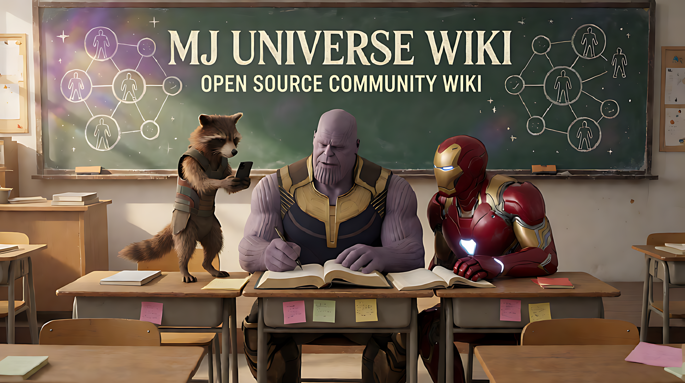

# MJ宇宙设定集｜人物、关系、世界线与经典梗

**简体中文** · [English](i18n/en/README.md) · [日本語](i18n/ja/README.md) · [한국어](i18n/ko/README.md) · [繁體中文](i18n/zh-Hant/README.md)

**MJ Universe Wiki · 全网首个开源 MJ 宇宙设定集。欢迎所有乐子人一起补全人物、性格、关系、世界线和故事套路！**

灭建国是谁？蚁人去哪里了？“这下玩大了”是谁对谁说的？

`mj-universe-wiki` 整理哔哩哔哩（B站）、抖音等平台上 MJ宇宙／漫威二创短视频的人物性格、家长姓名、家谱关系、经典梗和评论区共创。覆盖校园、常规宇宙整活、日常生活与灭霸／绿巨人 CP 等版本，方便查设定、写台本、做视频，也欢迎一起完善这份社区 Wiki。

> “全网首个开源”的定位基于截至 2026-11-01 的公开检索：目前未发现更早的同主题专门开源设定集，不代表穷尽所有平台与未索引项目。如果你知道更早的项目，欢迎通过 Issue 补充和纠正。[检索记录](docs/MJ_RESEARCH_NOTES.md)

不同作者和单集可以有不同版本。本资料库保留差异与出处，不替所有作品制定唯一正史。人物关系、亲属姓名和剧情机制均注明已知范围，欢迎纠错和补证。

## 从这里开始

| 想找什么 | 入口 |
| --- | --- |
| 灭霸、小浣熊、古一、浩克等 21 份档案；父母、后代与别名 | [人物档案](characters/README.md) |
| 13 份人物档案的三视图、概念设计与服装资料外链；8 份待补 | [外观参考](characters/README.md#外观参考) |
| 课堂、宇宙整活、日常、CP 与跨题材客串 | [宇宙与故事模式](universes/README.md) |
| 搭档、师生、CP 与关系未明的名字 | [人物关系](relationships/README.md) |
| 这下玩大了、姓名接龙、蚁人去哪了 | [梗与口头禅](memes/README.md) |
| emo 朋友圈、姓名攻防、整蛊反制 | [剧情套路](universes/patterns/README.md) |
| 2026-11-10 更新：班长、家庭称谓、连续世界线、早期投稿与故事变体 | [最新调研](docs/MJ_RESEARCH_NOTES.md) · [模式索引](universes/patterns/README.md) |
| 原片与评论的链接、观察范围 | [来源记录](sources/README.md) |
| MJ名称、胖蜘蛛侠图像、校园分支与灭建国的现实传播；2026-11-10更新 | [起源与传播史](docs/MJ_HISTORY.md) |
| 调研方法与历史检索 | [调研笔记](docs/MJ_RESEARCH_NOTES.md) |

本仓库以图文资料讲清人物、关系、世界线与经典梗。图片用于辅助理解具体条目或展示 Wiki：可以收录封面、人物识别图、关系图、必要截图，以及需要动作才能说明问题的简短 GIF。通用表情包、壁纸和贴图合集通过文字索引与外链介绍，整包素材留在外部存放位置。

资料以 Markdown 与 JSON 为主，可以单独下载、克隆和阅读；图片格式支持 JPG／JPEG、PNG、GIF、WebP。具体收录范围和提交方式见[图片贡献指南](CONTRIBUTING.md#图片与表情包怎么提交)，本地检查只需 Python 3 标准库。

## 从经典问题找设定

| 想查的问题 | 直接阅读 |
| --- | --- |
| 灭建国是谁？灭霸的爸爸妈妈叫什么？ | [灭建国](characters/灭建国.md) · [灭霸及其亲属版本](characters/灭霸.md) |
| 蚁人去哪里了？ | [蚁人去哪了](memes/蚁人去哪了.md) · [蚁人人物档案](characters/蚁人.md) |
| 小浣熊为什么总是第一个知道消息？ | [最强信息位与行为规律](characters/小浣熊.md) |
| “这下玩大了”一般谁对谁说？ | [口头禅的对象与情境](memes/这下玩大了.md) |
| 灭霸发 emo 朋友圈，第二天为什么被嘲笑？ | [校园宇宙的故事模式](universes/校园宇宙/patterns/深夜emo次日被嘲笑.md) |
| 灭霸和绿巨人是什么关系？ | [CP 作者版本与证据边界](relationships/灭霸与浩克.md) |
| MJ宇宙从哪里来？谁先做出胖蜘蛛侠和灭建国？ | [已核对时间节点、回顾说法与待补证据](docs/MJ_HISTORY.md) |

## 写台本和做视频怎么用

1. 从[人物档案](characters/README.md)查角色定位、性格、关系与行为规律，选择需要的人物版本。
2. 到[宇宙与故事模式](universes/README.md)确定世界规则和剧情推进方式；共用梗、客串与特殊版本分别注明。
3. 顺着条目里的[来源记录](sources/README.md)核对原片、评论和版本差异，再组织对白与情节，避免混淆亲属、师生和搭档关系。

需要查看人物外观时，可从[外观参考](characters/README.md#外观参考)进入电影、游戏与同人设计页面。当前提供外链，尚无成套 MJ 校园三视图；外链素材的使用范围以来源方许可为准，不因本仓库索引而获得授权。

发现人物反应、关系细节或剧情模式还不完整，可以直接补一行资料或提一个 Issue；来自原片的新观察也能帮助下一个创作者。

## 资料怎样组织

- `characters/`：一个人物一份完整档案，记录定位、性格、行为、关系与宇宙差异。
- `universes/`：世界规则和故事模式；专属模式放在对应宇宙下，共用模式集中维护并互相引用。
- `relationships/` 与 `memes/`：跨宇宙共享的关系、姓名梗和口头禅。
- `sources/`：原片、评论、时间点与实际核对范围。

人物不会按宇宙复制多份；宇宙差异写回人物档案，宇宙页链接它。故事模式可以跨宇宙复用，客串单独注明采用的人物版本。

## 一起补设定

**只知道一个名字、一种性格、一次客串或一个经典桥段，也欢迎来补。** 不需要一次整理完整世界观，也不要求会写代码。

- 有线索、暂时不会改文件：在仓库的 Issues 里选择“补充设定或来源”。没有来源也可以提交线索，明确写“待核对”。
- 发现错误或版本冲突：选择“纠错与版本差异”，说明哪个条目、哪里不同。
- 想直接编辑：打开对应人物文件，在 GitHub 点编辑，按提示 Fork、提交修改并创建 Pull Request。
- 熟悉 Git：Fork → 新建分支 → commit → push 到自己的 Fork → 提 PR。固定维护者可获写权限，在本仓库推送分支并提 PR。

欢迎补充小浣熊为什么总能先知道消息、灭霸如何反击、角色在不同宇宙中的身份差异，以及原片和评论里的更多细节。已有说法也欢迎提出不同版本与证据。

具体步骤、可复制命令和贡献示例见[贡献指南](CONTRIBUTING.md)。每个条目独立维护，小修改也可以单独提交。

## 怎样记录才有用

“灭霸爸爸叫灭建国”和“浣小丽是谁”提供的信息不同：前者明确亲属方向，后者只证明名字出现。不要凭名字性别或两个人并列出现在标题里补出家谱。

片内设定、作者补充、评论共创、整理推断和原创扩写分开注明。缺少公开直接证据的初始说法另列为[待核对提案](sources/E01.md)，可以通过新来源继续修订。

## 支持这个设定集

如果这里帮你查到了设定、写出了台本，或者做出了视频，欢迎点一下右上角的 **Star ⭐**，方便以后找回来，也让更多同好看到这个项目。

欢迎把仓库分享给 MJ宇宙观众、短视频创作者和喜欢翻评论区的乐子人。知道一个名字、一个梗或一条世界线，就可以从[提 Issue 或 PR](CONTRIBUTING.md)开始贡献。

## 其他语言

本资料库提供英文、日文、韩文与繁体中文入口，翻译约定、术语表和覆盖状态见[多语言翻译](i18n/README.md)。中文（简体）是源语言；译文与中文冲突时以中文条目和来源记录为准。欢迎补充其他语言的条目翻译。

## 许可与署名

本仓库贡献者有权授权的原创整理、概括与文档，以 [CC BY-SA 4.0](LICENSE) 许可共享。转载或修改时保留署名、许可与修改说明；推荐署名为“MJ 宇宙设定资料库贡献者”，并链接所用版本及贡献记录。

第三方角色形象、商标、原视频、原评论及其引用不因本仓库收录而改用此许可，仍由各自权利人享有相应权利。详见[署名与第三方资料说明](ATTRIBUTION.md)。
