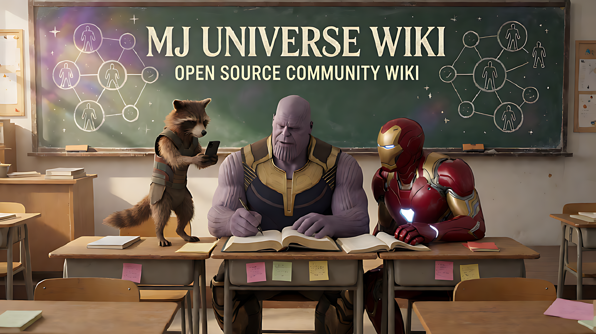

# MJ宇宙設定集｜人物、關係、世界線與經典梗

**繁體中文** · [简体中文](../../README.md) · [English](../en/README.md) · [日本語](../ja/README.md) · [한국어](../ko/README.md)

**MJ Universe Wiki · 全網首個開源 MJ 宇宙設定集。歡迎所有喜歡熱鬧的朋友一起補全人物、性格、關係、世界線與故事套路！**

滅建國是誰？蟻人去哪裡了？「這下玩大了」是誰對誰說的？

`mj-universe-wiki` 整理嗶哩嗶哩（B站）、抖音等平台上 MJ 宇宙／漫威二創短影片的人物性格、家長姓名、家譜關係、經典梗與留言區共創。涵蓋校園、常規宇宙整活、日常生活與薩諾斯／綠巨人 CP 等版本，方便查設定、寫腳本、做影片，也歡迎一起完善這份社群 Wiki。

> 「全網首個開源」的定位基於截至 2026-11-01 的公開檢索：目前未發現更早的同主題專門開源設定集，不代表窮盡所有平台與未索引專案。如果你知道更早的專案，歡迎透過 Issue 補充和糾正。[檢索記錄](docs/MJ_RESEARCH_NOTES.md)

不同作者與單集可以有不同版本。本資料庫保留差異與出處，不替所有作品制定唯一正史。人物關係、親屬姓名與劇情機制均註明已知範圍，歡迎糾錯與補證。

## 從這裡開始

| 想找什麼 | 入口 |
| --- | --- |
| 薩諾斯、火箭浣熊、古一、浩克等 21 份檔案；父母、後代與別名 | [人物檔案](characters/README.md) |
| 13 份人物檔案的三視圖、概念設計與服裝資料外鏈；8 份待補 | [外觀參考](../../characters/README.md#外观参考) |
| 課堂、宇宙整活、日常、CP 與跨題材客串 | [宇宙與故事模式](universes/README.md) |
| 搭檔、師生、CP 與關係未明的名字 | [人物關係](relationships/README.md) |
| 這下玩大了、姓名接龍、蟻人去哪了 | [梗與口頭禪](memes/README.md) |
| emo 社群貼文、姓名攻防、整蠱反制 | [劇情套路](universes/patterns/README.md) |
| 2026-11-10 更新：班長、家庭稱謂、連續世界線、早期投稿與故事變體 | [最新調研](docs/MJ_RESEARCH_NOTES.md) · [模式索引](universes/patterns/README.md) |
| 原片與留言的連結、觀察範圍 | [來源記錄](sources/README.md) |
| MJ 名稱、胖蜘蛛人圖像、校園分支與滅建國的現實傳播；2026-11-10 更新 | [起源與傳播史](docs/MJ_HISTORY.md) |
| 調研方法與歷史檢索 | [調研筆記](docs/MJ_RESEARCH_NOTES.md) |

本倉庫以圖文資料講清人物、關係、世界線與經典梗。圖片用於輔助理解具體條目或展示 Wiki：可以收錄封面、人物識別圖、關係圖、必要截圖，以及需要動作才能說明問題的簡短 GIF。通用表情包、桌布和貼圖合集透過文字索引與外鏈介紹，整包素材留在外部存放位置。

資料以 Markdown 與 JSON 為主，可以單獨下載、複製與閱讀；圖片格式支援 JPG／JPEG、PNG、GIF、WebP。具體收錄範圍和提交方式見[圖片貢獻指南](../../CONTRIBUTING.md#图片与表情包怎么提交)，本機檢查只需 Python 3 標準函式庫。

## 從經典問題找設定

| 想查的問題 | 直接閱讀 |
| --- | --- |
| 滅建國是誰？薩諾斯的爸爸媽媽叫什麼？ | [滅建國](characters/灭建国.md) · [薩諾斯及其親屬版本](characters/灭霸.md) |
| 蟻人去哪裡了？ | [蟻人去哪了](memes/蚁人去哪了.md) · [蟻人人物檔案](characters/蚁人.md) |
| 火箭浣熊為什麼總是第一個知道消息？ | [最強情報位與行為規律](characters/小浣熊.md) |
| 「這下玩大了」一般誰對誰說？ | [口頭禪的對象與情境](memes/这下玩大了.md) |
| 薩諾斯發 emo 貼文，第二天為什麼被嘲笑？ | [校園宇宙的故事模式](universes/校园宇宙/patterns/深夜emo次日被嘲笑.md) |
| 薩諾斯和綠巨人是什麼關係？ | [CP 作者版本與證據邊界](relationships/灭霸与浩克.md) |
| MJ 宇宙從哪裡來？誰先做出胖蜘蛛人與滅建國？ | [已核對時間節點、回顧說法與待補證據](docs/MJ_HISTORY.md) |

## 寫腳本和做影片怎麼用

1. 從[人物檔案](characters/README.md)查角色定位、性格、關係與行為規律，選擇需要的人物版本。
2. 到[宇宙與故事模式](universes/README.md)確定世界規則和劇情推進方式；共用梗、客串與特殊版本分別註明。
3. 順著條目裡的[來源記錄](sources/README.md)核對原片、留言和版本差異，再組織對白與情節，避免混淆親屬、師生和搭檔關係。

需要查看人物外觀時，可從[外觀參考](../../characters/README.md#外观参考)進入電影、遊戲與同人設計頁面。目前提供外鏈，尚無成套 MJ 校園三視圖；外鏈素材的使用範圍以來源方許可為準，不因本倉庫索引而獲得授權。

發現人物反應、關係細節或劇情模式還不完整，可以直接補一行資料或提一個 Issue；來自原片的新觀察也能幫助下一個創作者。

## 資料怎樣組織

- `characters/`：一個人物一份完整檔案，記錄定位、性格、行為、關係與宇宙差異。
- `universes/`：世界規則和故事模式；專屬模式放在對應宇宙下，共用模式集中維護並互相引用。
- `relationships/` 與 `memes/`：跨宇宙共享的關係、姓名梗和口頭禪。
- `sources/`：原片、留言、時間點與實際核對範圍。

人物不會按宇宙複製多份；宇宙差異寫回人物檔案，宇宙頁連結它。故事模式可以跨宇宙重複使用，客串單獨註明採用的人物版本。

## 一起補設定

**只知道一個名字、一種性格、一次客串或一個經典橋段，也歡迎來補。** 不需要一次整理完整世界觀，也不要求會寫程式。

- 有線索、暫時不會改檔案：在倉庫的 Issues 裡選擇「補充設定或來源」。沒有來源也可以提交線索，明確寫「待核對」。
- 發現錯誤或版本衝突：選擇「糾錯與版本差異」，說明哪個條目、哪裡不同。
- 想直接編輯：開啟對應人物檔案，在 GitHub 點編輯，按提示 Fork、提交修改並建立 Pull Request。
- 熟悉 Git：Fork → 建立分支 → commit → push 到自己的 Fork → 提 PR。固定維護者可獲寫入權限，在本倉庫推送分支並提 PR。

歡迎補充火箭浣熊為什麼總能先知道消息、薩諾斯如何反擊、角色在不同宇宙中的身分差異，以及原片和留言裡的更多細節。已有說法也歡迎提出不同版本與證據。

具體步驟、可複製指令和貢獻範例見[貢獻指南](CONTRIBUTING.md)。每個條目獨立維護，小修改也可以單獨提交。

## 怎樣記錄才有用

「薩諾斯的爸爸叫滅建國」和「浣小麗是誰」提供的資訊不同：前者明確親屬方向，後者只證明名字出現。不要憑名字性別或兩個人並列出現在標題裡就補出家譜。

片內設定、作者補充、留言共創、整理推斷和原創擴寫分開註明。缺少公開直接證據的初始說法另列為[待核對提案](sources/E01.md)，可以透過新來源繼續修訂。

## 支持這個設定集

如果這裡幫你查到了設定、寫出了腳本，或者做出了影片，歡迎點一下右上角的 **Star ⭐**，方便以後找回來，也讓更多同好看到這個專案。

歡迎把倉庫分享給 MJ 宇宙觀眾、短影音創作者和喜歡翻留言區的朋友。知道一個名字、一個梗或一條世界線，就可以從[提 Issue 或 PR](CONTRIBUTING.md)開始貢獻。

## 其他語言

本資料庫提供英文、日文、韓文與繁體中文入口，翻譯約定、術語表和覆蓋狀態見[多語言翻譯](../README.md)。中文（簡體）是源語言；譯文與中文衝突時以中文條目和來源記錄為準。歡迎補充其他語言的條目翻譯。

## 授權與署名

本倉庫貢獻者有權授權的原創整理、概括與文件，以 [CC BY-SA 4.0](../../LICENSE) 授權共享。轉載或修改時保留署名、授權與修改說明；推薦署名為「MJ 宇宙設定資料庫貢獻者」，並連結所用版本及貢獻記錄。

第三方角色形象、商標、原影片、原留言及其引用不因本倉庫收錄而改用此授權，仍由各自權利人享有相應權利。詳見[署名與第三方資料說明](ATTRIBUTION.md)。
